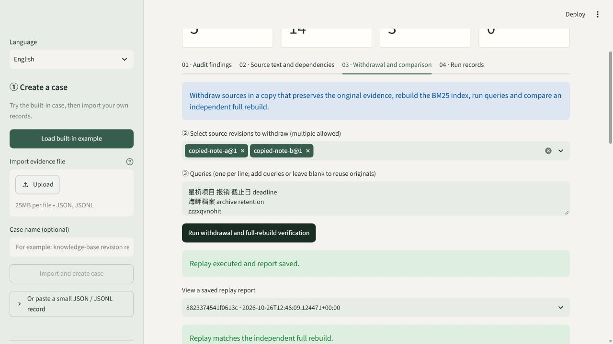

# RAG Source Audit Workbench

English · [简体中文](README.zh-CN.md)

**Turn a RAG record into a verifiable case: audit sources and spans, withdraw source revisions in an isolated copy, rebuild the retrieval index, and compare an independent full rebuild.**

This is a local, single-user, offline engineering tool. The core uses only the Python standard library; the optional bilingual interface uses Streamlit. No account, API key, paid API, or GPU is required.



[Chinese case overview](docs/assets/overview.png)

[View the joint-withdrawal comparison](docs/assets/replay.png) · [Controlled evaluation results](examples/controlled-evaluation.json) · [Validation scope and commands](docs/VALIDATION.md)

## Quick start

Requires Python 3.11 or later. Run these commands from the repository root.

On Windows, double-click **启动工作台.cmd**. On its first run, the launcher creates a project-local `.venv`, installs the free Python packages needed for the interface, and opens the local workbench. To install manually:

```powershell
python -m venv .venv
.\.venv\Scripts\python.exe -m pip install -e ".[ui,dev]"
.\.venv\Scripts\python.exe -m streamlit run ui.py
```

With an existing Python environment:

```powershell
python -m pip install -e ".[ui]"
python -m streamlit run ui.py
```

The interface starts in Simplified Chinese. Select **English** in the sidebar's **语言 / Language** control. Switching language retains the current case, selected source, withdrawal set, queries, and saved reports; it does not execute another replay. Only interface text and human-readable Markdown reports are translated. Source text, source titles, queries, source IDs, hashes, and JSON protocol fields remain unchanged.

1. Click **Load built-in example**, or upload bundle JSON / supported M4 or M5 JSONL.
2. Inspect findings, source revisions, trust metadata, highlighted source spans, and derived dependencies.
3. Select one or more active source revisions, edit the query set, and click **Run withdrawal and full-rebuild verification**.
4. Compare candidates and actual context before and after withdrawal. Check full-rebuild equivalence, then export the full JSON / Markdown report or a sharing summary without source text.
5. Click **Verify event chain** to check the local ledger.

Loading the same example again reuses the evidence bundle and does not overwrite source revisions. The interface stores local data in `.rag-audit/evidence.sqlite` under the project directory. To use another directory, set it before launch:

```powershell
$env:RAG_AUDIT_HOME = "D:\RagAuditData"
python -m streamlit run ui.py
```

On Linux / macOS, use `python3`, `.venv/bin/python`, and `RAG_AUDIT_HOME=/path/to/data python -m streamlit run ui.py` as appropriate. The repository does not ship private historical data, runtime databases, or third-party models.

## CLI and Python integration

Install the core package for command-line or SDK use:

```powershell
python -m pip install -e .
python -m rag_audit --lang en --help
python -m rag_audit demo --lang en --db .rag-audit/evidence.sqlite
python -m rag_audit inspect examples/demo-bundle.json --lang en
python -m rag_audit replay examples/demo-bundle.json --lang en --withdraw copied-note-a@1 --withdraw copied-note-b@1 --output replay-report.json
python -m rag_audit verify --lang en --db .rag-audit/evidence.sqlite
python -m rag_audit benchmark --lang en --output benchmark-report.json
```

Use the actual `source_id@revision` values in the evidence bundle. Repeat `--withdraw` for joint withdrawal, and inspect the input first. `--lang en|zh` works before the command or after the subcommand; for example, `python -m rag_audit --lang en replay --help` or `python -m rag_audit report REPORT_ID --lang en --format markdown`. The default is `zh`. JSON reports and sharing summaries keep their fixed protocol regardless of language. Run `--help` for all options.

Exit codes: `0` means success with the requested checks passing; `1` means failed checks or incomplete audit coverage; `2` means an input or execution error. An import returning `1` still retains the evidence. Export files are not overwritten by default. Even `--force` cannot overwrite the active database, its sidecars, or input evidence.

Complete SDK example:

```python
from pathlib import Path

from rag_audit.demo import DEMO_QUERIES, DEMO_WITHDRAWALS, demo_bundle
from rag_audit.report import render_markdown
from rag_audit.service import Workbench

workbench = Workbench(Path(".rag-audit") / "evidence.sqlite")
bundle_id = workbench.ingest(demo_bundle(), label="My first case")
audit = workbench.audit(bundle_id)
print(audit["counts"])

report = workbench.replay(bundle_id, DEMO_WITHDRAWALS, DEMO_QUERIES)
print(report["validation"]["equivalent_to_full_rebuild"])
Path("replay-report.md").write_text(render_markdown(report, lang="en"), encoding="utf-8")
print(workbench.verify_ledger())
```

`render_markdown(report)` remains backward compatible and defaults to Chinese. Pass `lang="en"` for English. Language preferences do not enter the content-addressed identity of evidence bundles or intervention reports.

## Capabilities and boundaries

| Capability | Status | Evidence scope |
| --- | --- | --- |
| Unified evidence format, revisions, and hashes | Implemented | Checks supplied-record consistency; does not establish source truth |
| Audits of sources, spans, artifacts, and runs | Implemented | Findings link to records; missing information is explicit |
| External trust metadata | Implemented | Words such as “official” or “trusted” inside source text cannot raise privileges |
| CPU BM25 source withdrawal | Implemented | Withdraws source revisions, propagates invalidation, rebuilds and queries |
| Independent full-rebuild comparison | Implemented | Checks retrieval-record equivalence for fixed inputs, configuration, and queries |
| M4/M5 JSONL import | Implemented | Historical auditing and observational comparison, marked `imported_history` |
| Local case interface, reports, and event chain | Implemented | SQLite storage, JSON / Markdown export, and modification detection |
| Microsoft GraphRAG / graph and community-summary rebuilding | Not implemented | Requires separate adapters and validation |
| Real LLM generation and answer recovery | Not implemented | This release uses `answer=null`, `answer_kind=not_generated` |
| Malicious-source judgment, attacker attribution, global minimum-cause search | Not provided | Observed influence does not establish these conclusions |

Imported historical runs are not re-executed by the interface. Converting them to the unified format does not add rebuilding support for their original backend. Original evidence remains intact; withdrawal acts on an isolated copy. The tool does not automatically classify sources as malicious or delete original files.

BM25 document frequencies and average document length change with the source set. Replay must retrieve again, rather than merely remove withdrawn sources from an old Top-K. The full-rebuild reference checks this mechanism; it does not establish protection of a real generation model.

For external caches, this release checks only the field structure of `metadata.cache_binding={input_sha256, processor_version, config_sha256}`. Even when all fields are present, the actual binding remains `not_verified` and audit coverage has `complete=false`. The tool does not use those fields to certify safe cache reuse. Native BM25 cases without external caches are unaffected by this limitation.

The deliverable is an **integrable, replayable, reviewable engineering workflow**, without a claim of inventing source-provenance algorithms. Read retrieval effects alongside the query denominator, changes to normal queries, empty contexts, and rebuilding costs.

## Format and adapters

- [Evidence protocol](docs/FORMAT.md): fields, stable references, Unicode character spans, execution states, reports, and validation boundaries.
- [Adapter guide](docs/ADAPTERS.md): historical log conversion, indexing your own text, and requirements for future backends.
- [Approved initial implementation plan](docs/superpowers/plans/2026-10-26-rag-audit-v01.md): tasks and acceptance scope.

These supporting documents are currently in Chinese. Source text is HTML-escaped in the interface. Full JSON reports include original text and replay snapshots; Markdown retains queries and source references. Review exports before external sharing. The dedicated sharing summary contains only fingerprints, allowlisted numeric aggregates, and validation results, excluding original text, queries, labels, and source IDs. It explicitly sets `replayable=false`: it communicates aggregate results and cannot replace complete replay material. Edited or redacted input is new evidence content and should receive a new hash and revision.

## Local verification

```powershell
python -m pip install -e ".[ui,dev]"
python -m pytest -q
python -m build
python -m rag_audit benchmark --lang en --output benchmark-report.json
```

Tests cover withdrawal/full-rebuild equivalence, import formats, references and spans, storage transactions, the event chain, and Chinese/English interface workflows: built-in cases, failed imports, replay, state retention on language switches, CLI localization, and stable machine JSON. Interface tests skip if the optional UI dependency is absent; install `ui` before release validation.

The hash chain can detect changes inconsistent with a known ledger state. If an attacker rewrites the entire database and every external checkpoint, checking the database alone cannot establish that history was preserved. Keep important checkpoints independently.

See [CHANGELOG.md](CHANGELOG.md) for release changes. License: MIT. Example text and implementation were independently authored.
