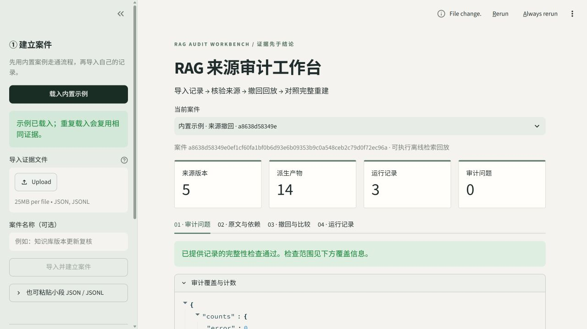

# RAG 来源审计工作台

[English](README.md) · 简体中文

**把一份 RAG 记录变成可核验的案件：检查来源与跨度，在副本中撤回源版本，真实重建检索索引，并与独立完整重建比较。**

这是本地、单用户、离线运行的工程工具。核心依赖 Python 标准库；可选双语页面使用 Streamlit。无需账户、密钥、付费 API 或 GPU。



[查看联合撤回后的比较页面](docs/assets/replay.png) · [受控验收结果](examples/controlled-evaluation.json) · [验证范围与命令](docs/VALIDATION.md)

## 快速运行

需要 Python 3.11 或更高版本。在本项目根目录执行：

Windows 可直接双击根目录的 **启动工作台.cmd**。首次运行会自动建立项目内 `.venv` 并安装页面所需的免费 Python 包；随后打开本地工作台。手动安装方式如下：

```powershell
python -m venv .venv
.\.venv\Scripts\python.exe -m pip install -e ".[ui,dev]"
.\.venv\Scripts\python.exe -m streamlit run ui.py
```

已有 Python 环境时，也可以直接执行：

```powershell
python -m pip install -e ".[ui]"
python -m streamlit run ui.py
```

页面默认使用简体中文；左侧 **语言 / Language** 可切换为 **English**。切换语言保留当前案件、已选来源、撤回集合、查询和已保存报告，不触发新回放。应用只翻译界面与 Markdown 报告；原文、标题、查询、来源 ID、哈希和 JSON 协议字段保留原样。

页面操作顺序：

1. 点击左侧“载入内置示例”，或上传统一 JSON / 受支持的 M4、M5 JSONL。
2. 查看审计问题、来源版本、信任状态、原文高亮和派生依赖。
3. 选择一个或多个活动来源版本，编辑查询集合，点击“执行撤回与完整重建验证”。
4. 检查撤回前后候选、实际上下文和完整重建一致性，导出完整 JSON / Markdown 或不含原文的分享摘要。
5. 点击“验证事件链”，复核本地账本的一致性。

重复载入相同示例会复用证据包，不覆盖已有来源版本。页面在项目目录的 `.rag-audit/evidence.sqlite` 保存本地数据。可在启动前设置独立存储目录：

```powershell
$env:RAG_AUDIT_HOME = "D:\RagAuditData"
python -m streamlit run ui.py
```

Linux / macOS 可使用 `python3`、`.venv/bin/python` 和 `RAG_AUDIT_HOME=/path/to/data python -m streamlit run ui.py`。交付仓库不包含私有历史数据、运行数据库或第三方模型。

## CLI 与 Python 接入

仅使用命令行或 SDK 时安装核心包：

```powershell
python -m pip install -e .
python -m rag_audit --lang zh --help
python -m rag_audit demo --db .rag-audit/evidence.sqlite
python -m rag_audit inspect examples/demo-bundle.json
python -m rag_audit replay examples/demo-bundle.json --withdraw copied-note-a@1 --withdraw copied-note-b@1 --output replay-report.json
python -m rag_audit verify --db .rag-audit/evidence.sqlite
python -m rag_audit benchmark --output benchmark-report.json
```

撤回引用以示例包中的实际 `source_id@revision` 为准。可重复传入 `--withdraw` 执行联合撤回；先运行 `inspect` 核对输入。具体参数以 `--help` 为准。`--lang zh|en` 可置于主命令前或子命令后，例如 `python -m rag_audit --lang en replay --help`、`python -m rag_audit report REPORT_ID --lang en --format markdown`。默认 `zh`；JSON 和分享摘要保持固定协议，不随语言翻译。

退出码：`0` 成功且所要求检查通过；`1` 检查失败或审计覆盖不足；`2` 输入或执行错误。导入返回 `1` 时仍保留证据。普通导出文件默认不覆盖；`--force` 也不能覆盖正在使用的数据库、其 sidecar 或输入证据。

完整 SDK 例子：

```python
from pathlib import Path

from rag_audit.demo import DEMO_QUERIES, DEMO_WITHDRAWALS, demo_bundle
from rag_audit.report import render_markdown
from rag_audit.service import Workbench

workbench = Workbench(Path(".rag-audit") / "evidence.sqlite")
bundle_id = workbench.ingest(demo_bundle(), label="我的第一个案件")
audit = workbench.audit(bundle_id)
print(audit["counts"])

report = workbench.replay(bundle_id, DEMO_WITHDRAWALS, DEMO_QUERIES)
print(report["validation"]["equivalent_to_full_rebuild"])
Path("replay-report.md").write_text(render_markdown(report, lang="zh"), encoding="utf-8")
print(workbench.verify_ledger())
```

`render_markdown(report)` 继续默认输出中文；传入 `lang="en"` 输出英文。语言设置不进入证据包或干预报告的内容寻址身份。

## 已实现能力与边界

| 能力 | 首版状态 | 证据范围 |
| --- | --- | --- |
| 统一证据格式、版本与哈希 | 已实现 | 检查给定记录的一致性；不保证采集内容真实 |
| 来源、跨度、产物、运行记录审计 | 已实现 | 问题可回到对应记录；缺项明确标注 |
| 外部 trust 元数据 | 已实现 | 正文中的“官方”“可信”等词不能提升权限 |
| CPU BM25 源撤回 | 已实现 | 撤回源版本，传播派生失效，重新构建并查询 |
| 独立完整重建对照 | 已实现 | 核验固定输入、配置、查询下的检索记录等价性 |
| M4/M5 JSONL 导入 | 已实现 | 历史记录审计与观察比较，标记 `imported_history` |
| 本地案件页面、报告与事件链 | 已实现 | SQLite 存储、JSON / Markdown 导出、修改检测 |
| Microsoft GraphRAG / 图、社区摘要重建 | 尚未实现 | 后续阶段需独立适配与验证 |
| 真实 LLM 生成、答案恢复率 | 尚未实现 | 首版 `answer=null`、`answer_kind=not_generated` |
| 恶意判断、攻击者归因、全局最小原因搜索 | 未提供 | 影响变化不能自动升级为这些结论 |

历史导入不会被页面重新执行，也不会因为转换成统一格式而获得原后端的重建能力。原始证据保留，撤回作用于隔离副本；首版不自动替用户作恶意判定或删除原始文件。

BM25 的全局词频与平均长度会随源集合变化。回放需要重新检索，不能只从旧 Top-K 中删去撤回来源。完整重建对照验证这一机制；它不等价于真实生成模型的保护效果。

外部缓存的 `metadata.cache_binding={input_sha256, processor_version, config_sha256}` 在首版仅核验字段形态。即使字段齐全，实际绑定仍为 `not_verified`，并使审计覆盖 `complete=false`；本工具不据此验证缓存可安全复用。没有外部缓存的原生 BM25 案件不受该限制影响。

本项目的成果定位是**可接入、可回放、可复核的工程闭环**，不主张首创来源追溯算法。检索级效果应连同查询分母、正常查询变化、空上下文和重建成本一起阅读。

## 格式与外部适配

- [完整证据协议](docs/FORMAT.md)：字段、稳定引用、Unicode 字符跨度、执行状态、报告与校验边界。
- [适配器说明](docs/ADAPTERS.md)：已有日志转换、自有文本建库和未来后端接入约束。
- [批准的首版实现计划](docs/superpowers/plans/2026-10-26-rag-audit-v01.md)：任务与验收范围。

原文在页面上经过 HTML 转义。完整 JSON 报告包含原文和回放快照，Markdown 保留查询与来源引用；对外分享前自行核对内容。专用“分享摘要”只保留哈希、白名单数值和验证结果，不含原文、查询、标签或来源 ID，并明确标记 `replayable=false`。它用于分享汇总结论，不能代替完整回放材料。修改或脱敏后的输入是新的证据内容，应生成新的哈希与版本。

## 本地验证

```powershell
python -m pip install -e ".[ui,dev]"
python -m pytest -q
python -m build
python -m rag_audit benchmark --output benchmark-report.json
```

测试覆盖默认后端撤回与完整重建等价性、格式导入、引用与跨度、存储事务、事件链，以及中英文页面中的示例、错误导入、执行流程、切换状态保留、CLI 语言选项和机器 JSON 稳定性。没有安装可选 UI 依赖时，页面测试会跳过；发布验收应安装 `ui` 后再运行。

哈希链能发现与已知账本状态不一致的修改。若攻击者能同时改写全部数据库与所有外部检查点，仅检查数据库本身不能证明历史未被重写。请将重要检查点保存在独立位置。

版本变化见 [CHANGELOG.md](CHANGELOG.md)。许可证：MIT。示例文本与本项目实现为独立编写。
